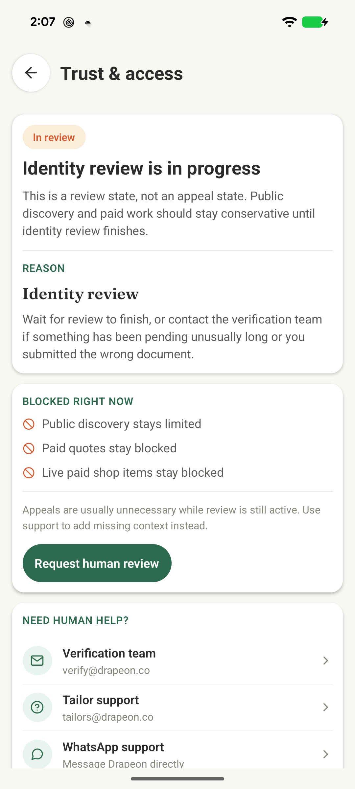
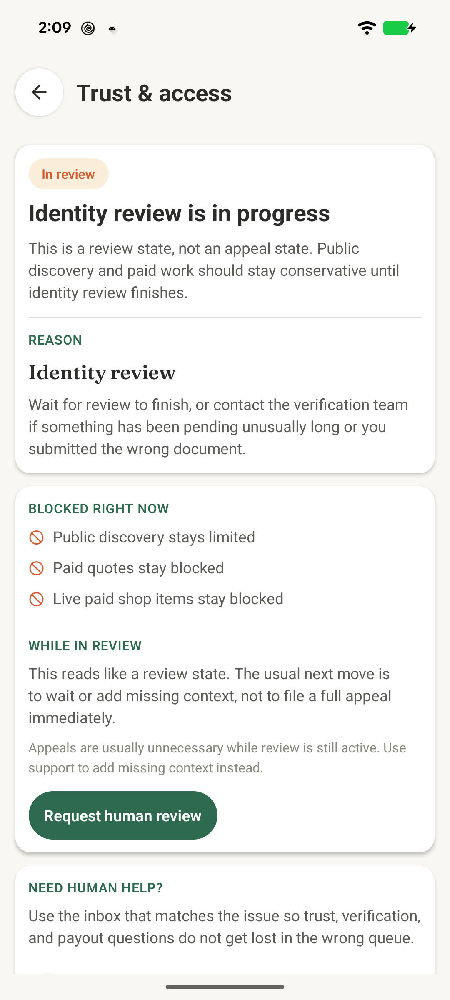
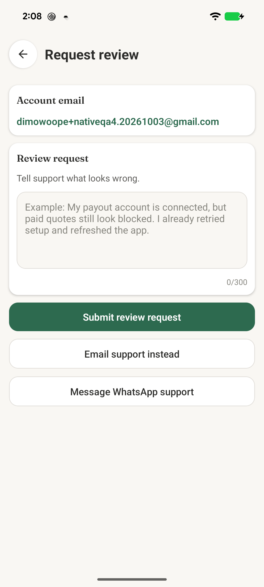
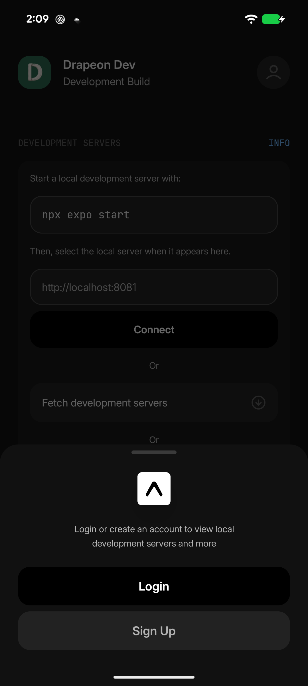
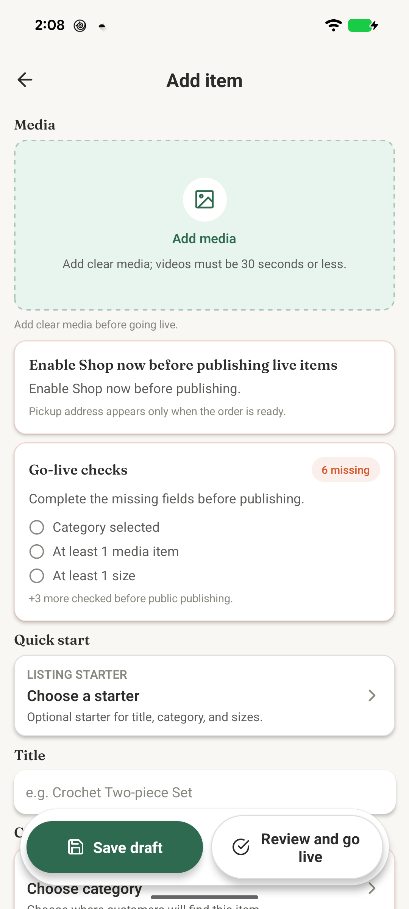

# Batch A declutter evidence

This branch is intentionally a draft until the complete requested device matrix is captured.

## Scope

- Tailor setup
- Trust access
- Access review
- New shop item
- Shared action-error strings
- Removal of three zero-import UI cards

Payout setup is explicitly excluded pending the separate payout work.

## Before and after

| Screen | Android before | Android after |
| --- | --- | --- |
| Trust access |  |  |
| Access review |  |  |
| New shop item |  |  |

## Evidence still required

- Tailor setup before/after on Android. The available authenticated QA account has already completed setup and the route cannot be reopened without changing account state.
- All four screens on an iPhone SE-sized simulator/device.
- All four screens on a large iPhone simulator/device.

The available iOS simulator is signed out, and no authenticated fixture was available during this pass. These gaps are why the pull request remains a draft.

## Copy and behavior notes

- The edited screen copy is shorter and action-led; live statuses, blockers, required disclosures, disabled-state reasons, and recovery actions remain.
- The exact identity consent text is unchanged.
- The unsupported 24-hour trust-review promise is removed.
- Shared load/save connection failures now use one canonical source. A separate unknown-outcome message is defined and tested for order/payment-style actions where retrying could duplicate work.
- Access-review success preserves the status and next step. No reference ID is displayed because the existing endpoint does not return one; inventing one or changing that contract would violate this batch's copy/layout-only constraint.
- No API contract, navigation, persistence, validation, approval, payment, or order logic is changed.

## Word-count accounting

The approved inventory records the baseline and proposed reductions for the explanatory copy on each screen. This batch implements those approved cuts. Counts deliberately exclude field labels, validation messages, live status values, blocker text, disclosures, and action labels, since those are functional rather than explanatory clutter.

## Deleted components

- `PaymentTrustCard`
- `BrandCompanionCard`
- `GreetingCard`

Repository-wide import searches returned zero consumers before deletion.
